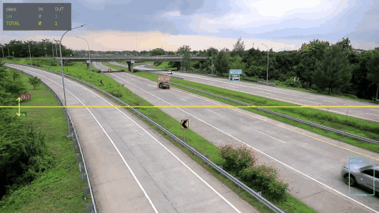
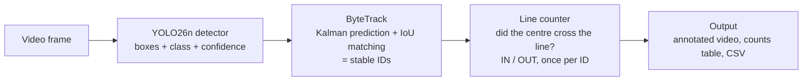
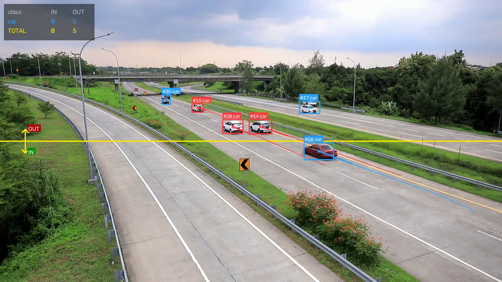
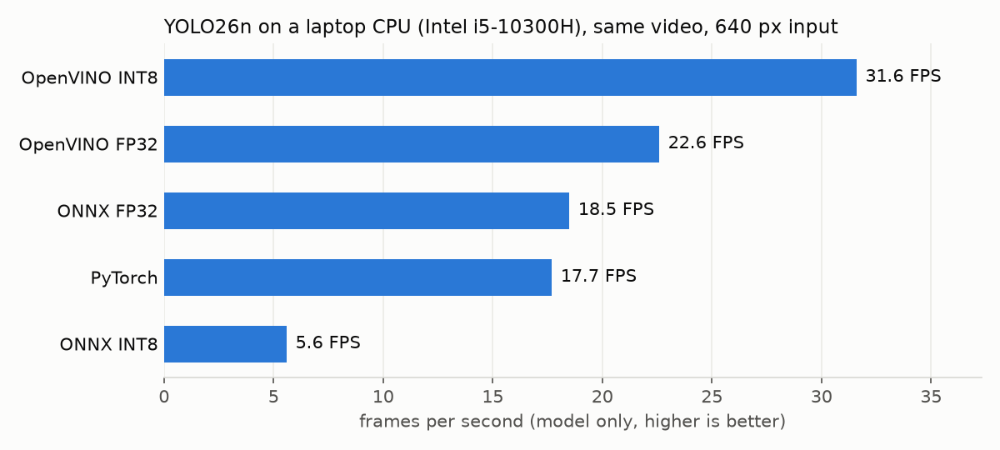
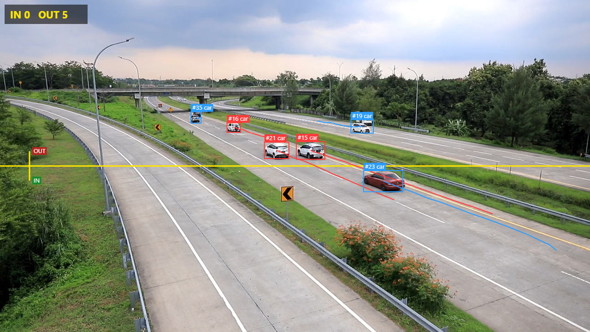

# Smart Traffic & People Counter

[](https://www.python.org/)
[](LICENSE)
[](https://huggingface.co/spaces/Amjad11/traffic-people-counter)

**Detects cars, bikes, buses, trucks and people in a video, tracks each one with an ID, and counts
how many cross a line in each direction — fast on a normal laptop CPU, and live in the browser.**



**Live demo: https://huggingface.co/spaces/Amjad11/traffic-people-counter**
(runs entirely in your browser — your video is never uploaded; the first visit downloads ~25 MB)

## Features

- YOLO26n object detection (person, car, motorcycle, bus, truck)
- ByteTrack multi-object tracking with stable IDs
- **Own line-crossing logic** (no library): IN / OUT per class, each object counted once
- Draggable counting line at any position and angle (web app)
- Annotated output: boxes, IDs, motion trails, live count panel
- CSV export of every crossing (track ID, class, direction, frame, time)
- CPU speed-up with ONNX Runtime and OpenVINO (FP32 and INT8), measured, not guessed
- Two front ends: a Python/Gradio app and a browser app (ONNX Runtime Web, WebGPU)

## How it works



1. **Detect:** YOLO26n finds every object in the frame (box, class, confidence).
2. **Track:** ByteTrack predicts where each known object should be now (Kalman filter) and pairs
   predictions with new boxes by overlap (IoU), using the Hungarian algorithm. Same object, same ID.
3. **Count:** for each ID, the line counter remembers the last centre point. If the path from the
   old to the new centre crosses the line (2D cross-product side test + segment intersection), it
   counts once, as IN or OUT depending on the direction.

There are two versions of the same pipeline:

| | Python app (`app.py`) | Browser app (`web/`) — the live demo |
|---|---|---|
| Runs on | your computer (CPU) | the visitor's browser (WebGPU, or CPU) |
| Model | OpenVINO INT8 (fastest on CPU) | ONNX FP32, dynamic input size |
| Tracker / counter | Ultralytics ByteTrack + `counter/line_counter.py` | my JavaScript port of both (`web/js/`) |
| UI | Gradio | plain HTML/JS, no framework |

Why a browser version? Free Gradio hosting on Hugging Face Spaces became a paid (PRO) feature in
2026; static Spaces stay free. Running the model in the browser costs nothing to host and keeps
videos private.



## Results

All numbers come from scripts in `scripts/`, saved in `results/`. Hardware: Intel Core i5-10300H
laptop (8 logical cores, integrated Intel UHD graphics), Windows 11 (`results/benchmark_env.json`).
Test video: `samples/highway.mp4`, 1280×720, 330 frames.

### CPU speed per model format (`scripts/benchmark.py` → `results/benchmark.csv`)



| Format | Size | Model-only FPS | ms / frame | vs PyTorch | Full pipeline FPS | Counts IN / OUT |
|---|---|---|---|---|---|---|
| PyTorch | 5.5 MB | 17.7 | 56.4 | 1.00× | 12.9 | 1 / 8 |
| ONNX FP32 | 9.9 MB | 18.5 | 54.2 | 1.05× | 11.8 | 1 / 8 |
| ONNX INT8 | 3.1 MB | 5.6 | 178.8 | 0.32× | 7.4 | 1 / 8 |
| OpenVINO FP32 | 10.1 MB | 22.6 | 44.3 | 1.28× | 15.5 | 1 / 8 |
| **OpenVINO INT8** | **3.4 MB** | **31.6** | **31.7** | **1.79×** | **19.4** | 1 / 8 |

- OpenVINO INT8 is the fastest and smallest, and **INT8 did not change the counts** on this video.
- ONNX INT8 was **3× slower**: this CPU has no fast INT8 (VNNI) instructions and ONNX Runtime adds
  quantize/dequantize steps; OpenVINO fuses them. Lesson: measure on the target hardware.
- Model-only FPS is the median of 3 runs over 150 frames after a 10-frame warm-up.

### Tracking and counting on the sample video

- 17 track IDs over 330 frames, average track length 59.7 frames (`results/tracking_stats.json`)
- Counts: **1 IN, 8 OUT**, all cars (`results/highway_summary.json`, events in `results/highway_events.csv`)
- Note: these counts have **not yet been checked against a hand count** of the video.

### Browser app speed (`scripts/benchmark_web.py` → `results/web_benchmark.csv`)

| Setup (headless Edge, same laptop) | Model ms / frame | ≈ FPS (detection) | Boxes matching Python |
|---|---|---|---|
| WebGPU, square 640×640 input (first version) | 160.5 | 4.5 | 28/28 |
| **WebGPU, 640×384 input (live site)** | **109.5** | **6.1** | 28/28 |
| CPU (WASM, 1 thread) | 240.3 | 3.2 | 28/28 |
| WebGPU on a *software* GPU (acceleration off) | 7534.7 | 0.1 | 28/28 |
| WebNN (experimental flag in Edge 157) | 47.9 | 8.3 | 28/28 |

- Whole pipeline (detect + track + count + draw) on the live setup: **8.24 FPS** (`results/web_tracking_check.json`).
- A 16:9 video is fed as 640×384 instead of a padded 640×640 square (dynamic-shape ONNX), like
  Ultralytics' own PyTorch inference: ~1.5× faster.
- If the browser only offers a software GPU, the app switches to the CPU automatically (≈ 27× faster
  than software WebGPU here: 283 vs 7,555 ms per frame). WebNN is tried first and will be used once browsers enable it.
- Speeds depend on the visitor's device; these are for the laptop above.

### Does the browser give the same answer as Python?

| Check | Result |
|---|---|
| Detection, 7 frames (`scripts/check_web.py` → `results/web_check.json`) | 28/28 boxes matched, mean IoU 0.99 |
| Tracker, fed Python's exact detections (`tests/tracker_parity.test.mjs`) | identical IDs on all 330 frames, boxes within 0.5 px, identical events |
| Whole pipeline (`results/web_tracking_check.json`) | same totals (1 IN / 8 OUT), all 9 crossings on the same frames; some ID *numbers* differ |

Tried and rejected, with measurements: skipping every 2nd frame (tracking broke: 0 of 9 crossings);
a 480 px input (not faster on WebGPU, missed a small car).



## Run locally

**Python app** (Windows, Python 3.12):

```bash
py -3.12 -m venv .venv
.venv\Scripts\activate
pip install -r requirements.txt
python scripts/export_models.py   # ONNX + OpenVINO models into models/ (optional, ~2 min)
python app.py                     # Gradio app at http://127.0.0.1:7860
python scripts/run_video.py       # or: command line, saves video + CSV to results/
python scripts/benchmark.py       # reproduce the CPU speed table
```

**Browser app:**

```bash
python scripts/build_web.py       # assembles web_dist/ (needs models/yolo26n_dynamic.onnx)
python -m http.server -d web_dist 8000   # open http://localhost:8000
python scripts/deploy_space.py    # deploy to a static Hugging Face Space (after `hf auth login`)
```

**Tests:**

```bash
python tests/test_line_counter.py        # Python line counter (7 tests)
node --test "tests/*.test.mjs"           # JS line counter + tracker parity with Python (11 tests)
python scripts/check_web.py track        # whole browser pipeline vs Python (needs Microsoft Edge)
```

## Project structure

```
app.py                  Gradio app
counter/                detector (YOLO + ByteTrack), line_counter (my logic), draw, pipeline
web/                    browser app: index.html, js/ (detector, kalman, tracker, lineCounter, draw, main)
scripts/                export, benchmarks, browser checks, assets, build + deploy
tests/                  Python and JavaScript tests, tracking reference fixture
results/                every number in this README (CSV / JSON)
samples/highway.mp4     sample video
```

## What I learned

- **Measure, don't assume:** INT8 was 1.8× faster with OpenVINO but 3× *slower* with ONNX Runtime on
  the same CPU; a smaller input was not faster on WebGPU; skipping frames silently broke tracking.
- **Tracking needs frame-to-frame overlap.** ByteTrack matches by IoU, so dropping frames makes fast,
  close objects look new every time.
- **Porting needs proof.** I checked the JavaScript port against Python at three levels (detections,
  tracker on identical input, whole pipeline), which caught real bugs (empty-matrix matching, missing
  box clipping at the frame edge).
- **Deployment is part of the product:** browser caching (fixed with version-stamped files), slow
  first loads (progress bar), software-GPU fallback, and a 402 when free hosting rules changed.

## Credits and licence

- Detection and tracking: [Ultralytics YOLO](https://github.com/ultralytics/ultralytics) (AGPL-3.0),
  in-browser inference: [ONNX Runtime Web](https://onnxruntime.ai/).
- Sample video: [Elevated View of Highway with Traffic](https://www.pexels.com/video/elevated-view-of-highway-with-traffic-10995755/) (Pexels, free licence).
- Because Ultralytics is AGPL-3.0, this project is released under the **[AGPL-3.0](LICENSE)** as well.
